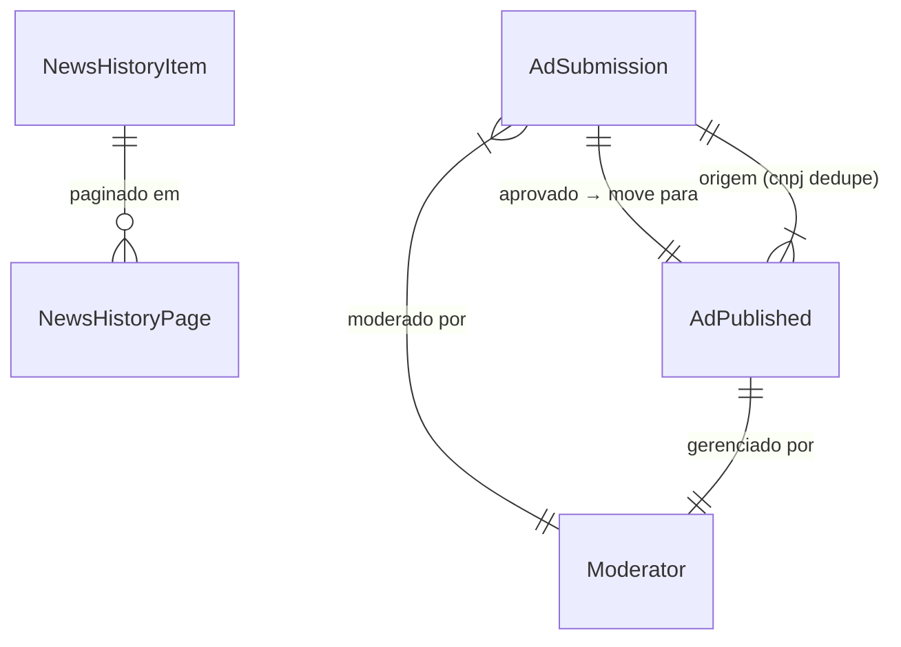

# Data Model: Fase 2 — Persistência e Captura de Interesse

**Date**: 2026-10-24  
**Spec**: specs/002-fase2-persistencia-captura/spec.md  
**Research**: specs/002-fase2-persistencia-captura/research.md

---

## Entities

### 1. NewsHistoryItem (Notícia Persistida)

Representa uma notícia armazenada no histórico além do cache volátil de 15 min.

**Arquivo**: `src/modules/news-history/types.ts`  
**Armazenamento**: `src/content/news-history.json` (array)

```typescript
interface NewsHistoryItem {
  // Identificação única (hash para deduplicação)
  id: string;                    // SHA-256 hex truncado: hash(título_normalizado + fonte + data_iso)
  
  // Conteúdo principal
  title: string;                 // Título original (sanitizado, máx. 200 chars)
  summary: string;               // Resumo curto (sanitizado, máx. 500 chars)
  source: string;                // Nome da fonte (ex.: "G1 São Carlos", "São Carlos Agora")
  sourceUrl: string;             // Link para matéria original (https, validado)
  publishedAt: string;           // ISO 8601 (data da publicação original)
  
  // Metadados de coleta
  collectedAt: string;           // ISO 8601 (quando o portal coletou/armazenou)
  category?: string;             // Categoria/região se fornecida pela fonte (ex.: "Polícia", "Esportes")
  imageUrl?: string;             // URL da imagem do feed RSS (https, opcional)
  
  // Controle
  isActive: boolean;             // true = exibido na listagem; false = arquivado/removido
}
```

**Validação** (no loader/normalize):
- `title`, `summary`, `source`, `sourceUrl`, `publishedAt` obrigatórios
- `sourceUrl` deve ser URL válida https (via `lib/sanitize.ts`)
- `publishedAt` parseável como Date válida
- `id` gerado automaticamente: `crypto.createHash('sha256').update(`${normalizedTitle}|${source}|${publishedAt}`).digest('hex').slice(0, 16)`
- Deduplicação: mesmo `id` = mesma notícia (atualiza `collectedAt` se mais recente)

**Retenção** (FR-005, FR-028, LGPD legítimo interesse):
- Manter itens com `publishedAt` nos últimos **12 meses** (365 dias)
- Loader filtra automaticamente itens > 12 meses na leitura
- Script opcional `npm run cleanup:news-history` remove fisicamente do JSON

**Estado**: `isActive: true` → exibido; `false` → oculto (moderação manual se necessário)

---

### 2. AdSubmission (Submissão de Anúncio — Fila de Moderação)

Dados submetidos pelo comerciante via formulário público, aguardando revisão.

**Arquivo**: `src/modules/ads-pending/types.ts`  
**Armazenamento**: `src/content/ads-pending.json` (array)

```typescript
interface AdSubmission {
  // Identificação
  id: string;                    // UUID v4 (crypto.randomUUID())
  status: 'pendente' | 'aprovado' | 'recusado';
  
  // Dados do formulário (todos sanitizados via lib/sanitize.ts)
  businessName: string;          // Nome do comércio/serviço (obrigatório, máx. 100 chars)
  category: string;              // Categoria (obrigatório, enum das categorias de ads.json)
  description: string;           // Descrição curta (obrigatório, máx. 500 chars)
  neighborhood: string;          // Bairro/região (obrigatório, máx. 100 chars)
  phone: string;                 // Telefone/WhatsApp (obrigatório, formato válido BR)
  externalLink?: string;         // Link externo opcional (https, validado)
  businessHours?: string;        // Horário de atendimento textual (opcional, máx. 200 chars)
  cnpj: string;                  // CNPJ (obrigatório, só dígitos, válido módulo 11)
  
  // Metadados de submissão
  submittedAt: string;           // ISO 8601 (data/hora da submissão)
  submittedIp: string;           // IP do remetente (para rate limiting/auditoria)
  userAgent?: string;            // User-Agent (opcional, auditoria)
  
  // Moderação (preenchido pelo moderador)
  moderatedAt?: string;          // ISO 8601 (quando moderado)
  moderatedBy?: string;          // Identificador do moderador (ex.: "owner")
  rejectionReason?: string;      // Motivo da recusa (obrigatório se status=recusado)
  
  // LGPD / Retenção (FR-028, emenda v1.3.0)
  // - status=pendente: consentimento, expira em 30 dias se não moderado
  // - status=aprovado: segue regra de Anúncio Publicado (ativo + 12m)
  // - status=recusado: excluído/após 30 dias
}
```

**Validação** (cliente + servidor em `modules/ads-pending/submit.ts`):
- Todos campos obrigatórios preenchidos
- `phone`: regex BR `(\(?\d{2}\)?\s?)?(9?\d{4}-?\d{4})` + normalização para `55DDD9XXXXXXXX`
- `externalLink`: se presente, URL https válida
- `cnpj`: 14 dígitos, algoritmo módulo 11 válido
- `category`: deve estar na lista de categorias válidas (de `content/ads.json`)
- Rate limit: máx. 10 submissões/15min por IP (in-memory Map)
- Dedupe CNPJ: rejeita se já existe `AdSubmission` com mesmo CNPJ e status `pendente` ou `aprovado` (ou `AdPublished` ativo)

**Transições de estado**:
```
pendente → aprovado  (moderador aprova)  → move para AdPublished + remove de ads-pending.json
pendente → recusado  (moderador recusa)  → status=recusado, rejectionReason preenchido, notifica comerciante
pendente → (expiração 30d sem moderação) → status=recusado (auto), rejectionReason="Expirado sem moderação"
```

---

### 3. AdPublished (Anúncio Publicado — Anúncio Gratuito)

Anúncio aprovado, publicado publicamente no portal com `kind: "anuncio-gratuito"`.

**Arquivo**: `src/modules/ads/types.ts` (estende existente)  
**Armazenamento**: `src/content/ads.json` (array, campo `kind` distingue)

```typescript
interface AdPublished {
  // Identificação
  id: string;                    // UUID v4 (herdado da submissão ou novo)
  kind: 'anuncio-gratuito' | 'anuncio-patrocinado' | 'divulgacao-propria'; // NOVO valor
  status: 'publicado' | 'suspenso' | 'removido';
  
  // Dados do anúncio (copiados da submissão aprovada)
  businessName: string;
  category: string;
  description: string;
  neighborhood: string;
  phone: string;
  externalLink?: string;
  businessHours?: string;
  cnpj: string;                  // Armazenado para gestão/dedupe, NÃO exibido publicamente
  
  // Metadados de publicação
  approvedAt: string;            // ISO 8601 (data da aprovação)
  approvedBy: string;            // "owner"
  publishedAt: string;           // ISO 8601 (data da publicação efetiva)
  suspendedAt?: string;          // Se suspenso
  removedAt?: string;            // Se removido
  
  // LGPD / Retenção (FR-028, emenda v1.3.0)
  // Base legal: Legítimo interesse (art. 7º, IX LGPD)
  // Prazo: enquanto ativo + 12 meses após remoção/expiração
  // Ação pós-prazo: exclusão automática ou anonimização
}
```

**Validação**:
- `kind` obrigatoriamente `"anuncio-gratuito"` para anúncios vindos do formulário
- `status` padrão `"publicado"` na aprovação
- `cnpj` único entre anúncios com `status: "publicado"` e `kind: "anuncio-gratuito"`

**Ações do moderador** (FR-019, `modules/ads/manage.ts`):
- **Editar**: atualiza campos (exceto `id`, `cnpj`, `kind`, `approvedAt`)
- **Suspender**: `status: "suspenso"`, `suspendedAt: now` → oculta da exibição pública
- **Remover**: `status: "removido"`, `removedAt: now` → oculta + inicia contagem 12m para LGPD
- **Reativar**: `status: "publicado"`, limpa `suspendedAt` (se estava suspenso)

---

### 4. Moderator (Moderador/Proprietário)

Ator único com acesso à área de moderação. Não é entidade persistida — autenticação via segredo.

**Autenticação** (`lib/auth.ts`):
```typescript
function verifyModerator(secret: string | null): boolean {
  const expected = process.env.MODERATOR_SECRET;
  if (!expected) return false; // Segredo não configurado = acesso negado
  return secret === expected;
}
```

**Uso**:
- Header `x-moderator-secret` ou query `?secret=...` nas rotas `/moderacao/*` e `/api/ads/*`
- Middleware/layout em `/moderacao/layout.tsx` verifica e retorna 401 se inválido
- Segredo configurado apenas no Vercel (Production), não em `.env.example`

---

### 5. NewsHistoryPage (Página de Listagem Paginada)

Resultado da consulta paginada para `/noticias`.

**Arquivo**: `src/modules/news-history/types.ts`

```typescript
interface NewsHistoryPage {
  items: NewsHistoryItem[];
  page: number;                  // 1-indexed
  pageSize: number;              // 20 (constante)
  totalItems: number;            // Total de itens ativos no histórico
  totalPages: number;            // Math.ceil(totalItems / pageSize)
  hasNextPage: boolean;
  hasPreviousPage: boolean;
  lastUpdated: string;           // ISO 8601 (última atualização do histórico)
  sourceStatus: 'ok' | 'stale' | 'error'; // Status da última coleta dos feeds
}
```

---

## Relationships



---

## Storage Schema (JSON Files)

### `src/content/news-history.json`
```json
[
  {
    "id": "a1b2c3d4e5f6g7h8",
    "title": "Chuva forte alaga ruas do centro de São Carlos",
    "summary": "Precipitação de 80mm em 2 horas causou alagamentos...",
    "source": "G1 São Carlos",
    "sourceUrl": "https://g1.globo.com/sp/sao-carlos-regiao/noticia/...",
    "publishedAt": "2026-10-20T14:30:00-03:00",
    "collectedAt": "2026-10-20T15:00:00-03:00",
    "category": "Cotidiano",
    "imageUrl": "https://s2.glbimg.com/.../image.jpg",
    "isActive": true
  }
]
```

### `src/content/ads-pending.json`
```json
[
  {
    "id": "550e8400-e29b-41d4-a716-446655440000",
    "status": "pendente",
    "businessName": "Padaria do João",
    "category": "Alimentação",
    "description": "Pães artesanais, bolos caseiros e café fresquinho.",
    "neighborhood": "Centro",
    "phone": "5516981442301",
    "externalLink": "https://instagram.com/padariadojoao",
    "businessHours": "Seg-Sex 6h-19h, Sáb 6h-14h",
    "cnpj": "12345678000199",
    "submittedAt": "2026-10-24T10:15:00-03:00",
    "submittedIp": "200.100.50.25",
    "userAgent": "Mozilla/5.0..."
  }
]
```

### `src/content/ads.json` (estendido)
```json
[
  {
    "id": "550e8400-e29b-41d4-a716-446655440000",
    "kind": "anuncio-gratuito",
    "status": "publicado",
    "businessName": "Padaria do João",
    "category": "Alimentação",
    "description": "Pães artesanais, bolos caseiros e café fresquinho.",
    "neighborhood": "Centro",
    "phone": "5516981442301",
    "externalLink": "https://instagram.com/padariadojoao",
    "businessHours": "Seg-Sex 6h-19h, Sáb 6h-14h",
    "cnpj": "12345678000199",
    "approvedAt": "2026-10-24T11:00:00-03:00",
    "approvedBy": "owner",
    "publishedAt": "2026-10-24T11:00:00-03:00"
  },
  {
    "id": "anuncio-patrocinado-1",
    "kind": "anuncio-patrocinado",
    "status": "publicado",
    "...": "..."
  }
]
```

---

## Constants & Enums

```typescript
// src/modules/ads-pending/types.ts
const AD_CATEGORIES = [
  'Alimentação',
  'Serviços',
  'Comércio',
  'Saúde',
  'Educação',
  'Beleza',
  'Automotivo',
  'Construção',
  'Tecnologia',
  'Outros'
] as const;

type AdCategory = typeof AD_CATEGORIES[number];

// src/modules/news-history/types.ts
const NEWS_HISTORY_PAGE_SIZE = 20;
const NEWS_HISTORY_RETENTION_DAYS = 365; // 12 meses

// src/modules/ads-pending/types.ts
const AD_PENDING_RETENTION_DAYS = 30; // consentimento LGPD
const RATE_LIMIT_MAX_REQUESTS = 10;
const RATE_LIMIT_WINDOW_MS = 15 * 60 * 1000; // 15 min
```

---

## Validation Rules Summary

| Entity | Rule | Location |
|---|---|---|
| NewsHistoryItem | `id` unique, `sourceUrl` https, `publishedAt` valid Date | `normalize.ts` |
| NewsHistoryItem | Retenção: `publishedAt > now - 365d` | `loader.ts` (filtro) |
| AdSubmission | Todos campos obrigatórios | `submit.ts` (client + server) |
| AdSubmission | `phone` formato BR válido | `submit.ts` + `lib/sanitize.ts` |
| AdSubmission | `externalLink` https se presente | `submit.ts` |
| AdSubmission | `cnpj` 14 dígitos + módulo 11 | `lib/cnpj.ts` |
| AdSubmission | `category` in `AD_CATEGORIES` | `submit.ts` |
| AdSubmission | Rate limit 10/15min/IP | `lib/rate-limit.ts` |
| AdSubmission | Dedupe CNPJ (pendente/aprovado/publicado) | `submit.ts` |
| AdPublished | `kind === "anuncio-gratuito"` se do formulário | `approve.ts` |
| AdPublished | CNPJ único entre `kind="anuncio-gratuito" && status="publicado"` | `manage.ts` / `approve.ts` |